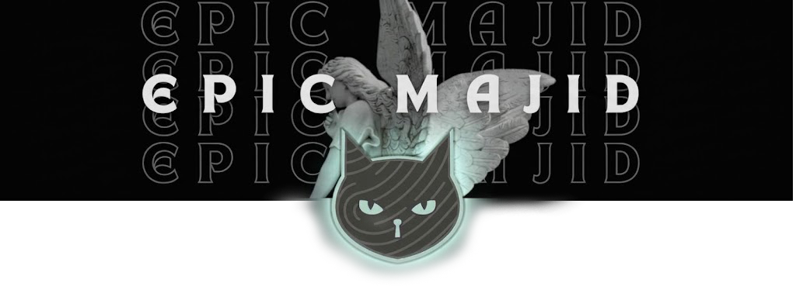

<!-- صورتك الخاصة (الملاك والقط) -->

  

<!-- الاسم متوهج (الطريقة المضمونة من الملف النصي) -->

<!-- اللقب متوهج -->

 

<!-- المهارات التي طلبتها فقط -->

  
  
  
  
  

I’m **epicmajid** - a Control & Systems Engineer, Programmer, and Malware Simulation Developer.

I work at the intersection of **industrial automation, software development, and offensive security**. My work is about more than just coding: it is about understanding how systems operate at their core, validating how real attackers exploit them, and turning offensive insights into unbreakable defenses.

I build custom tools, game hacks, and educational malware PoCs to test system integrity in isolated environments.

> **Current research interests:** Windows Internals, System Exploitation, Malware Development (Simulations), Game Modding, and PLC Programming.

<h2 style="color: #C6ECE3;">About Me 🪪</h2>

#### 🚀 Control & Systems Engineer
- Specializing in system architecture, automation, and control logic design.
- Expert in C++, Python, MATLAB, and PLC programming for both industrial and software applications.
- Developing custom security tools and destructive simulations for isolated testing environments (Kali Linux & Windows VMs).

#### 🎮 When I'm not engineering systems, you’ll find me:
- Immersed in the gaming world, analyzing game engines and mechanics.
- Developing external tools and scripts for game modding and memory manipulation.
- Exploring new tech innovations and pushing the boundaries of what a system can handle.

#### 🔒 My Mission
- Passionate advocate for understanding offensive tactics (like virus creation and system wipers) to build stronger defenses.
- Empowering developers to test their systems in extreme, isolated environments.
- Actively contributing to the cybersecurity community through educational simulations and open-source tooling.

<h3 style="color: #C6ECE3;">What you'll find here 🚀</h3>

- 🦠 **Malware Simulations:** Advanced Scareware and Ransomware simulators built for isolated environments.
- 🔧 **Offensive Tools:** Python and C++ based tools for memory reading, automation, and system exploitation.
- 💻 **Game Modding:** Scripts and tools designed to interact with game engines and memory.
- ⚙️ **Control Systems:** MATLAB scripts and PLC logic implementations for automation.

<h3 style="color: #C6ECE3;">My Skills (Services) ⚔️</h3>

<table align="center">
<tr>
<td width="50%" valign="top">

#### Engineering & Coding

</td>
<td width="50%" valign="top">

#### Offensive Security & Malware

</td>
</tr>
<tr>
<td width="50%" valign="top">

#### Operating Systems & Labs

</td>
<td width="50%" valign="top">

#### Interests

</td>
</tr>
</table>

<h2 style="color: #C6ECE3;">Currently 🎯</h2>

- 🔬 Researching low-level Windows internals and memory manipulation
- 🪟 Building advanced malware simulations and system wipers for VM testing
- 🟣 Developing C++ and Python tools for game hacking and automation
- ✍️ Exploring the intersection of PLC programming and software development
- 🧩 Experimenting with automation, AI-assisted workflows, and creative coding

<!-- قسم التحليلات والدراسة -->
<h2 style="color: #C6ECE3;">System Analytics 📊</h2>

### 🎓 Academic Focus & Learning Path
- **Major:** Control & Systems Engineering.
- **Currently Mastering:** Advanced C++ Memory Manipulation, Windows API, and Reverse Engineering.
- **Next Target:** ICS/SCADA Security and Advanced Malware Development.

 

<!-- بطاقة الطرفية (Terminal Stats) -->

<!-- لعبة الثعبان -->
<h2 style="color: #C6ECE3;">Let's Play a Game 🐍</h2>

  

<!-- التواصل (في النهاية) -->
<h2 style="color: #C6ECE3;">Let's Connect 🚀</h2>

I’m open to technical collaboration, security research, open-source work, and game dev projects.

<!-- عداد الزوار في النهاية -->

